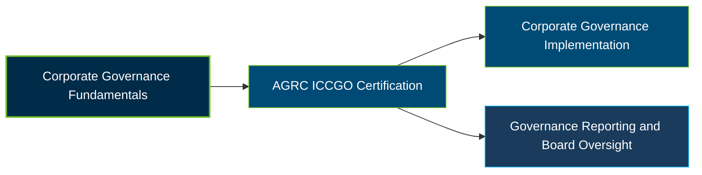

# AGRC International Certified Corporate Governance Officer (ICCGO) Certification Exam Guide

A dedicated, comprehensive study guide and governance reference repository for candidates preparing for the **AGRC International Certified Corporate Governance Officer (ICCGO) Certification Exam**.

---

## Exam Overview

The AGRC International Certified Corporate Governance Officer (ICCGO) certification validates knowledge of corporate governance principles, board responsibilities, organizational controls, risk management, and governance reporting practices.

- **Exam Format**: Multiple-choice examination following a mandatory four-day workshop.
- **Target Audience**: Corporate Governance Officers, Board and Committee Secretaries, Compliance Professionals, Risk Managers, Internal Auditors, and Corporate Management Professionals.
- **Prerequisites**: Completion of the required four-day ICCGO workshop before sitting the examination. No separate academic prerequisite is stated on the official programme page.

---

## Core Exam Domains & Knowledge Areas

### 1. Corporate Governance Principles and Frameworks

- Corporate governance definitions, characteristics, importance, determinants, and core principles.
- Parties involved in corporate governance and their roles in organizational oversight.
- Board structures, board composition, director responsibilities, and board committee functions.

### 2. Transparency, Disclosure and Board Effectiveness

- Corporate transparency, disclosure practices, accountability, and stakeholder relationships.
- Board diversity and inclusion, director responsibilities, and trust-based board relationships.
- Effective board meetings, governance procedures, and committee responsibilities.

### 3. Corporate Governance and Risk Management

- Corporate governance integration with organizational risk management and internal controls.
- Risk sources, risk identification, and impact assessment.
- Internal audit responsibilities and the three-lines-of-defence model.

### 4. Anti-Corruption and Organizational Integrity

- Financial and administrative corruption risks and their organizational impact.
- Anti-corruption mechanisms and internal control practices.
- Governance oversight approaches that support integrity and accountability.

### 5. Corporate Governance Reporting

- Corporate governance report components, structure, and disclosure requirements.
- Preparation of corporate governance reports and sample reporting exercises.
- Review and examination of corporate governance reports from different organizations.

---

## Certification Path

The following diagram illustrates a suggested learning progression for corporate governance professionals. It is not an official AGRC certification pathway.

---

## Recommended Practice & Study Resources

Combine the official AGRC workshop and programme outline with practical corporate governance review and supplementary examination preparation.

- **CertsGate**: Explore [AGRC ICCGO certification preparation resources](https://certsgate.com/exams/agrc/iccgo), including supplementary study materials and practice questions for reviewing corporate governance concepts.
- **Practical Study Resources**: Apply corporate governance principles to board structures, committee responsibilities, risk assessments, internal audit controls, anti-corruption mechanisms, and sample corporate governance reports.
